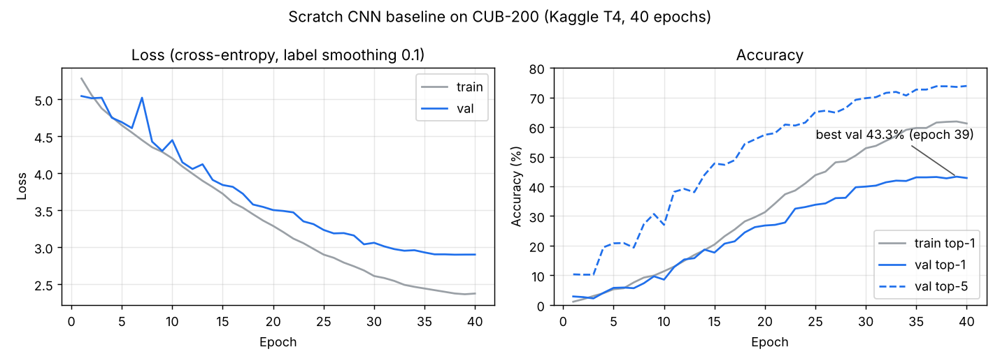

# Milestone 1 — Training framework and scratch CNN baseline (Sameh)

**Owner:** Mohamed Sameh · **Date:** 28 Oct 2026 · **Plan card:** "Core framework and scratch CNN"

## Result

The from-scratch CNN baseline reached **43.3% top-1** and **73.5% top-5** accuracy on our
validation split (899 images, 200 species) after 40 epochs on a Kaggle T4 GPU.
Random guessing gives 0.5%; the plan expected 20–40%.

| | Value |
|---|---|
| Val top-1 accuracy (best epoch) | **43.27%** (epoch 39 of 40) |
| Val top-5 accuracy | **73.53%** |
| Val loss (plain cross-entropy, `evaluate`) | 2.285 |
| Train top-1 accuracy at epoch 39 (with augmentation) | 61.9% |
| Parameters | 4.82 M (encoder 4.71 M + head 0.10 M), all trainable |
| Training time | 13.1 min (≈19 s / epoch) on 1 × Tesla T4 |
| Run | Kaggle notebook Version 1 · MLflow run `ce3cf43f9c7f41239e52ae86924b007c` (experiment `cls-scratch`; logged before the team switched to W&B) |
| Code | commit `15edc79` on `main`, `configs/cls_scratch.yaml` unchanged |
| Environment | Kaggle, PyTorch 2.11 + CUDA 12.8 (our `requirements.txt` pins 2.14) |
| Checkpoint | `best.pt` (58 MB) on the team Google Drive — not in git |



**Reading the curves**

- Accuracy grew slowly for 10 epochs, fast from 10 to 30, then flattened as the cosine
  schedule brought the learning rate to almost zero.
- Val loss fell from 5.05 to 2.90 and levelled off over the last ~5 epochs without turning up,
  so the model did not start to overfit badly.
- Train accuracy (61.9%) is above val (43.3%) from about epoch 20 on, even though train
  images are augmented and dropout is on during training. A gap this size is normal with only
  ~25 images per species; it is the main limit of the scratch model.
- Val top-1 has about ±3 points of noise (899 images). Test numbers come later, once, for the
  final models only.

## What I built (7 commits on `main`)

| Commit | Files | What it does |
|---|---|---|
| Seeding, device, typed config | `src/utils/seed.py`, `device.py`, `config.py`, `configs/cls_scratch.yaml` | One seed for Python/NumPy/PyTorch/workers; picks CUDA, MPS or CPU; loads YAML into typed dataclasses, rejects unknown keys, `--override key=value` |
| Dataset and loaders | `src/data/datasets.py` | PyTorch `Dataset` over the HF split + Walid's `split.json` and transforms → `(3, 224, 224)` tensors, train/val/test loaders |
| Encoder interface, scratch CNN, registry | `src/models/encoders/base.py`, `scratch_cnn.py`, `heads/classification.py`, `classifier.py`, `registry.py` | Shared `Encoder` interface (multi-scale features, pooled vector, freeze/unfreeze, Grad-CAM layer); 5-stage conv–BN–ReLU CNN; dropout + linear head; models built from config by name |
| Trainer + tracking | `src/training/trainer.py`, `classification.py`, `optim.py`, `tracking.py`, `run.py` | One training loop for any task: mixed precision, warmup + cosine schedule, early stopping, `best.pt` / `last.pt` / `history.csv`, resume; the tracker logs config, per-epoch metrics, git commit, versions, GPU (MLflow at first, Weights & Biases since 28 Oct) |
| CLI | `src/cli.py`, `src/evaluation/inference.py` | `train`, `evaluate` (val or test, saves `.npz` predictions), `predict` (top-5 species for one image) |
| Kaggle launcher | `notebooks/kaggle_launcher.ipynb` | Clones the repo and runs the CLI on a free T4 — no logic in the notebook |
| Docs | `README.md`, `docs/experiment_log.md` | Setup and exact commands; experiment log |

Plus 17 tests (`tests/test_config.py`, `test_datasets.py`, `test_models.py`, `test_trainer.py`);
`pytest -q` passes all 28 with Walid's.

## Scratch CNN architecture

| Stage | Layers | Output (224 × 224 input) |
|---|---|---|
| 0 | 2 × (Conv3×3 → BatchNorm → ReLU), MaxPool 2×2 | 32 × 112 × 112 |
| 1 | same | 64 × 56 × 56 |
| 2 | same | 128 × 28 × 28 |
| 3 | same | 256 × 14 × 14 |
| 4 | same | 512 × 7 × 7 |
| Pool | Global average pooling | 512 |
| Head | Dropout 0.3 → Linear | 200 logits |

Kaiming init, no pretrained weights anywhere.

## Training settings (`configs/cls_scratch.yaml`)

| Setting | Value | Why |
|---|---|---|
| Optimizer | AdamW, lr 1e-3, weight decay 5e-4 | Reliable for a scratch network with little tuning |
| Schedule | 2 warmup epochs, then cosine to 1% of lr | Gentle start while BatchNorm settles, small steps at the end |
| Loss | Cross-entropy, label smoothing 0.1 | Less over-confidence with ~25 images per class |
| Batch / epochs | 64 / 40, early stopping patience 10 (not triggered) | Fits a T4; val-based stopping |
| Augmentation | Walid's: RandomResizedCrop(0.5–1.0), H-flip, ±15° rotation, mild brightness/contrast | From the EDA; no hue change (colour identifies species) |
| Normalization | ImageNet mean/std | Same input as the transfer model → fair comparison |
| Precision | Mixed (AMP) | ~2× faster on the T4 |

## How to reproduce

```bash
pip install -r requirements.txt
python -m src.cli train --task classification --config configs/cls_scratch.yaml
python -m src.cli evaluate --task classification --checkpoint outputs/checkpoints/<run_dir>/best.pt --split val
# runs appear on the team's W&B dashboard (wandb login first)
```

On Kaggle: `notebooks/kaggle_launcher.ipynb`, GPU T4 + Internet on, `WANDB_API_KEY` secret added, *Save Version → Save & Run All*.

## Output files (`results.zip` from Kaggle)

| File | Content | Kept where |
|---|---|---|
| `outputs/checkpoints/scratch-cnn-baseline_20261028-120537/best.pt` | Model at epoch 39 | Google Drive |
| `.../last.pt` | Model at epoch 40, for resuming | Local only |
| `.../history.csv` | Per-epoch losses, accuracies, learning rates, times | Source of the curves above |
| `outputs/predictions/scratch-cnn-baseline_20261028-120537_val.npz` | Logits + labels for the 899 val images | For metrics / Grad-CAM |
| `mlflow.db`, `mlruns/` | MLflow runs of this baseline (before the W&B switch) | Local, screenshots for the report |

## Next

- Try to improve the baseline as tracked experiments: 80 epochs, wider channels, 3 convs per stage, residual blocks.
- Add the `tune` CLI command once `src/training/tune.py` exists.
- Adam: add ResNet50 to `src/models/registry.py` (see `docs/experiment_log.md` for results to compare against).
